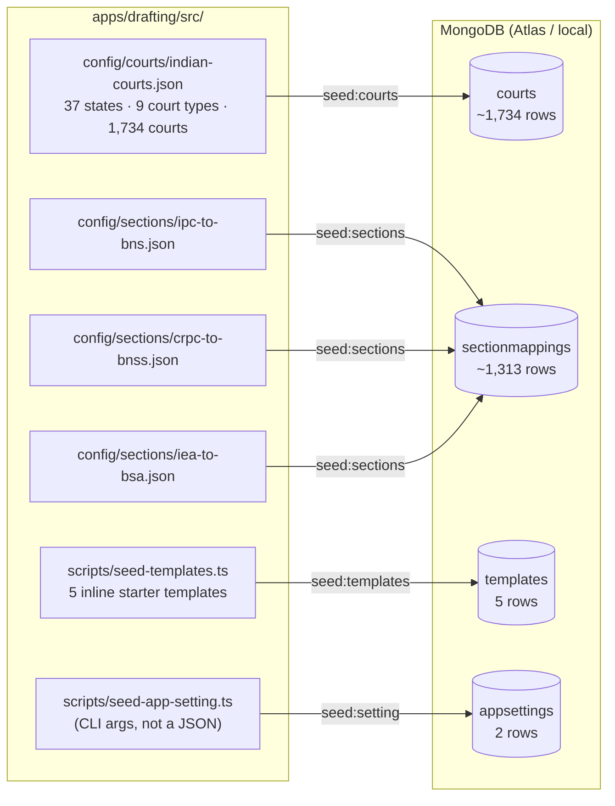
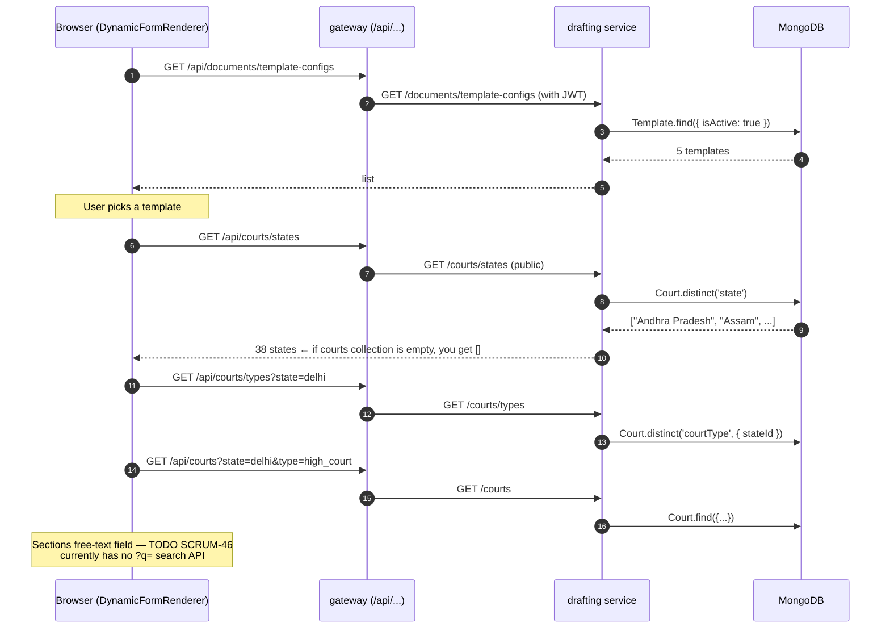

# Seeding the Lawie databases

Reference for every collection that gets populated from a static source file at the repo level. Run these on first boot of a new database (Atlas cluster, EC2 instance, fresh local Mongo) and again any time you change one of the source files in `apps/drafting/src/config/`.

> **T-371 (ADR-025 D2, 13 Oct 2026): the section tables need no reseed.** The drafting service now serves `config/sections/{ipc-to-bns,crpc-to-bnss,iea-to-bsa}.json`, `config/bns-offences.json` and `config/bns-triable-by.json` from memory, loaded at boot (`apps/drafting/src/services/signed-tables.ts`). It no longer reads the `sectionmappings` collection or the Redis `sections:*` cache. A table change ships with the deploy; check the SHA-256 of each file under `signedTables` in drafting `GET /health`. `seed:sections` and the `SectionMapping` model are deprecated and kept only until the collection is removed. The `seed:sections` rows and section 7 below are history.

The drafting service reads these collections at runtime — if they are empty, the new-document form has nothing to render and `/api/courts/states` returns `[]`. That is exactly the bug we hit on the demo box on 2026-05-11.

---

## 1. Source files → collections at a glance



What lives in JSON files in the codebase but is **not** seeded — these are read straight from disk at runtime by the drafting service:

- `apps/drafting/src/config/court-rules/*.json` — 15 court-specific formatting rule files (fonts, margins, cause-title format)
- `apps/drafting/src/config/document-rules/*.json` — 5 document-type rule files (bail, S138, etc.)
- `apps/drafting/src/config/bns-offences.json` and `bns-triable-by.json` — bail-checker reference (bailability is derived from `bns-offences.json` at load time by `services/bns-offence-resolver.ts`)
- `apps/billing/src/config/credit-skus.ts` — plan tiers + top-up SKUs powering `/api/billing/plans`

If you change any of these, redeploy the drafting (or billing) service — no DB step needed.

---

## 2. End-to-end data flow for the new-document form

This is the path the user is on when they click "New document" in the dashboard:



**Template scope on the court endpoints (T-425).** `/courts`, `/courts/types` and `/courts/states` accept `?template=<id>`. For the six bail packs (`bail_regular`, `bail_anticipatory`, `bail_before_magistrate`, `default_bail`, `interim_bail`, `bail_cancellation`) the result is limited to sessions courts, criminal-side `*_district` district courts, `high_court`, `high_court_bench` and, except for `bail_anticipatory`, `cjm`/`jmfc`. Consumer Commissions, NCDRC, Supreme Court, tribunals, `civil_court` and `district_court_generic` are excluded. `state` and `type` narrow further inside that scope. Passing a non-empty `level` together with a bail `template` returns 400 `level is not accepted for template <id>`. `suspension_of_sentence` and all other templates are unfiltered (`consumer_complaint` keeps its own T-411 `level` filter). `/courts/types` labels `high_court_bench` as "High Court Bench". Both web pickers, the brief `CourtPicker` and the classic-form `DynamicFormRenderer`, send `?template=<id>` for these six ids on states, types and courts; the id list in `apps/web/src/components/intake/bailCourts.ts` must match the one in `courts.routes.ts`, so change them together.

The "states dropdown empty" bug means step 5 returned `[]`. The fix is always: run `yarn workspace @lawie/drafting seed:courts` against that DB.

---

## 3. Per-script reference

| Script                | npm script                                                         | Source                                                        | Collection        | Idempotent?                                                                                                                                                                                                                                            |
| --------------------- | ------------------------------------------------------------------ | ------------------------------------------------------------- | ----------------- | ------------------------------------------------------------------------------------------------------------------------------------------------------------------------------------------------------------------------------------------------------ |
| `seed-courts.ts`      | `yarn workspace @lawie/drafting seed:courts`                       | `config/courts/indian-courts.json`                            | `courts`          | Yes — upsert on `courtId`                                                                                                                                                                                                                              |
| `seed-sections.ts`    | `yarn workspace @lawie/drafting seed:sections`                     | `config/sections/{ipc-to-bns, crpc-to-bnss, iea-to-bsa}.json` | `sectionmappings` | Yes — skips matches on `(oldCode, oldSection, isNewProvision)`, so it never corrects a row that already exists. Pass `--force` to delete all rows and reseed (see [section 7](#7-reseeding-sectionmappings-after-the-t-250--t-255-table-corrections)). |
| `seed-templates.ts`   | `yarn workspace @lawie/drafting seed:templates`                    | inline array in the script                                    | `templates`       | Yes — skip if `slug` exists                                                                                                                                                                                                                            |
| `seed-app-setting.ts` | `yarn workspace @lawie/drafting seed:setting <key> <value> [desc]` | CLI args                                                      | `appsettings`     | Yes — no-op if (key, value) already match                                                                                                                                                                                                              |

One-shot bootstrap of a fresh DB:

```bash
# Seeds courts, sectionmappings, templates against whichever MONGO_URI
# is in your .env.development (or NODE_ENV-matched .env file).
yarn workspace @lawie/drafting seed:all

# Set the AI model keys (DB is the only place these live — never in .env)
yarn workspace @lawie/drafting seed:setting ai.drafting_model claude-sonnet-4-6
yarn workspace @lawie/drafting seed:setting ai.preflight_model claude-haiku-4-5-20251001
```

Model prices live in `appsettings` as one JSON value per model, key `ai.rates.<model-slug>` (for example `ai.rates.claude-sonnet-4-6`). It holds four numbers, all USD per million tokens: `input_usd_per_mtok`, `output_usd_per_mtok`, `cache_write_usd_per_mtok` and `cache_read_usd_per_mtok`.
`cache_write_usd_per_mtok` must be the **1-hour** cache-write price, 2× input (for example `6` for Sonnet 4.6 at `3` input), because the drafting calls use only the 1-hour prompt cache (T-437).

All four scripts read `MONGO_URI` from `.env.${NODE_ENV ?? 'development'}` at the repo root.

---

## 4. Running seeds against demo / production

The demo EC2 box (`13.202.145.184`) runs the drafting service in a Docker container with `.env.demo` mounted. The cleanest way to seed against the demo Mongo is to exec into the container so it inherits the right `MONGO_URI`:

```bash
ssh -i lawie-demo-key.pem ubuntu@13.202.145.184
cd /home/ubuntu/lawie

# Option A — from inside the container (no env wiring needed)
docker exec lawie_drafting node dist/scripts/seed-courts.js
docker exec lawie_drafting node dist/scripts/seed-sections.js
docker exec lawie_drafting node dist/scripts/seed-templates.js

# Option B — from the host with the demo MONGO_URI in scope
docker exec -i lawie_drafting sh -c \
  'MONGO_URI=$MONGO_URI npx ts-node src/scripts/seed-courts.ts'
```

(The compiled `dist/scripts/*.js` files exist because `tsc` is part of the Docker image build.)

> ⚠️ **Demo and dev currently share one Atlas cluster** (`lawie-dev.bdyi886.mongodb.net`). Seeding "demo" is the same as seeding "dev" today. Before launching paying users we need a separate `lawie-prod` cluster and `.env.demo` updated accordingly — see [docs/environments.md](environments.md).

---

## 5. When to re-run each seed

| Source change                                            | Re-run                                                                                                         |
| -------------------------------------------------------- | -------------------------------------------------------------------------------------------------------------- |
| Adding rows to `indian-courts.json`                      | `seed:courts`                                                                                                  |
| Editing existing court name / formattingRulesRef in JSON | `seed:courts` (upsert overwrites)                                                                              |
| Deleting a court from JSON                               | `seed:courts` does **not** delete — handle manually in Mongo                                                   |
| Adding a new IPC↔BNS row                                 | Nothing since T-371: deploy the file; check its SHA-256 in drafting `GET /health`                              |
| Changing existing section mapping                        | Nothing since T-371: deploy the file; check its SHA-256 in drafting `GET /health`. Ajay signs the change first |
| Adding a starter template                                | `seed:templates`                                                                                               |
| Editing an existing template                             | Update the doc in Mongo directly, or delete + reseed                                                           |
| AI model swap (Anthropic releases new model)             | `seed:setting ai.drafting_model <new-id>`                                                                      |

---

## 6. Verifying a seed worked

```bash
# Count check
docker exec lawie_drafting node -e "
  require('mongoose').connect(process.env.MONGO_URI).then(async (m) => {
    const db = m.connection.db;
    for (const c of ['courts','sectionmappings','templates','appsettings']) {
      console.log(c.padEnd(20), await db.collection(c).countDocuments());
    }
    await m.disconnect();
  });
"

# Public API check (no auth needed)
curl -sk https://demo.lawie.in/api/courts/states | jq '.states | length'   # expect 38
curl -sk https://demo.lawie.in/api/sections/all/IPC | jq '. | length'      # > 500
```

After a successful seed the new-document form should show the full state dropdown, the court-type dropdown should populate when you pick a state, and the template list should have 5 entries.

---

## 7. Reseeding `sectionmappings` after the T-250 / T-255 table corrections

> **Superseded by T-371.** The service no longer reads `sectionmappings`, so this reseed is not needed for the read path. Kept as a record.

**Owner:** Arjun runs the reseed. Ajay (CLO) and Arjun agree the dates through Priya. Production is founder-only.

### What changed in the source files

- `iea-to-bsa.json` was replaced with the table Ajay (CLO) corrected and signed against the Gazette text (T-250; 117 of 185 rows were wrong). Six rows are now typed `repealed_no_equivalent`: IEA 2, 22A, 82, 88, 113 and 166.
- `crpc-to-bnss.json` was replaced with the table Ajay corrected and signed against the Gazette text (T-255; 103 of 535 rows were wrong, and `new_provisions` was corrected).
- The `SectionMapping` model accepts a new `mappingType`, `repealed_no_equivalent`.
- `ipc-to-bns.json` was replaced byte for byte with the table Ajay corrected and signed against the Gazette text (T-267; 233 of 576 rows changed). IPC 124A (sedition) and IPC 377 are repealed, and 14 rows are now "no equivalent". Four rows (IPC 236, 254, 292A and 376DA) are the new type `unverified`: no BNS section, and notes exactly `Not verified. Check the Gazette before citing a BNS section.`
- The `SectionMapping` model accepts a further `mappingType`, `unverified`.
- `seed-sections.ts` now sets `validatedBy` and `validatedAt` for all three tables (IPC, CrPC and IEA), from each file's `meta.validated_by` and `meta.last_updated`. IPC rows get the T-267 signature string from the file's meta and `validatedAt` 2026-10-12. `Pending CLO review` no longer applies to any table; it remains only the schema default for a table the script does not list as signed.
- `bns-mapping.json` no longer holds a second copy of the IPC table (`ipc_to_bns`, which nothing read). `ipc-to-bns.json` is the only IPC table.
- Bail checker: an IPC section with no BNS equivalent reports "No BNS equivalent. Check the Gazette". An explicit "NNN-IPC" that is not in the table reports "Not found in the IPC table. Check the Gazette". Neither is looked up as a BNS number. The message shows on the web page only after T-278.
- Seven document packs now cite the BNS sections from the table. These are code and config changes, so they are live at deploy and need no reseed. Only the converter and old-to-new conversion pairs read `sectionmappings`, so those need the reseed below.
- `notes` come from `notes`, else `note` (CrPC rows use `note`). For `repealed_no_equivalent` rows they fall back to `new_law_status`.
- `apps/drafting/src/scripts/apply-clo-patch.ts` is deleted. It wrote wrong pairs over the seed. **Never run it.** A stale compiled copy may still sit in a local, gitignored `dist/scripts/`; do a clean build before running any compiled seed.

### Why a plain `seed:sections` is not enough

Any database seeded from the old tables, or patched with `apply-clo-patch`, holds wrong pairs. Plain `seed:sections` skips every row that already exists, so it keeps them. This includes the corrected IPC pairs, the `unverified` type and the new IPC `validatedBy`: they reach a database only with `--force`.

Until a database is reseeded, the section converter and old-to-new conversions in drafts on that database still read the old, wrong pairs, and its IPC rows still show `Pending CLO review`. The code and JSON changes do not fix a database by themselves.

### Procedure

1. **Check for admin-edited rows.** `--force` deletes **all** `sectionmappings` rows, not just the seeded ones. Before running it on any database, confirm the collection holds only seeded rows: look at `updatedBy` and `updatedAt` for any row changed after the original seed. If an admin-edited row exists, do not run `--force`; raise it with Priya.
2. **Clean build** so no stale `dist/scripts/apply-clo-patch.js` or old `seed-sections.js` is present.
3. **Reseed develop first:**

   ```bash
   yarn workspace @lawie/drafting seed:sections --force
   ```

   On the demo box, from inside the container (section 4):

   ```bash
   docker exec lawie_drafting node dist/scripts/seed-sections.js --force
   ```

   Demo and dev share one cluster today (section 4), so this one run covers both.

4. **Sample these 30 rows** on develop and compare each against Ajay's signed tables: IEA 5, 32, 45, 62, 63, 65A, 65B, 100, 113A, 166; CrPC 41, 97, 154, 167, 362, 358, 437, 439, 482, 10; IPC 34, 124A, 236, 302, 304B, 307, 376, 377, 420, 498A. Also check that `validatedBy` is Ajay's signature for every IPC, CrPC and IEA row (IPC `validatedAt` is 2026-10-12), and that no row still says `Pending CLO review`. IPC 236 must be type `unverified` with no BNS section and the exact note above; 124A and 377 must be repealed.
5. **Production after that**, founder-only, and only after T-275 ships. T-275 adds the section-converter label for `repealed_no_equivalent` rows.
