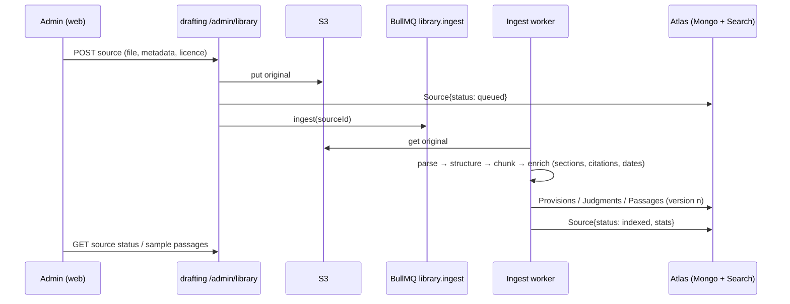

# Drafting v2 — System design

## 1. Services (no new service; two new workers)

| Component | Where | Notes |
|---|---|---|
| Library API (sources, provisions, judgments, passages, retrieval) | `apps/drafting` (new module `library/`) | Same service as drafting: one DB, no network hop on the hot path. Split out only if ingestion CPU hurts drafting latency (measure first). |
| Ingestion worker | `apps/drafting` worker process (`yarn workspace @lawie/drafting worker:ingest`), BullMQ queue `library.ingest` | Parses, chunks, enriches, embeds, indexes. Runs as its own pm2 app so a 300-page book never blocks a draft. |
| Compiler stages | `apps/drafting` drafting path (plan → retrieve → draft → verify → repair → render) | In-process pipeline for one draft (SSE to the user as today); stages are pure functions over a `DraftRun` document so a crash resumes from the last completed stage. |
| Admin panel | `apps/web` (admin routes, exist) | Sources, kinds, parts, sign-off, eval dashboard. |
| Search | MongoDB Atlas Search (BM25) + Atlas Vector Search (phase 2) | Index definitions in repo (`apps/drafting/atlas-search/*.json`), applied by a script; never hand-edited in the console. |
| Embeddings (phase 2) | Voyage AI `voyage-law-2` via HTTPS from the ingestion worker | Key in env, read-only, spend limit; batched; never on the user's request path (query embedding is one small call, cached by query hash in Redis for 1 h). |
| Object storage for uploaded files | S3 bucket (Mumbai), private, server-side encrypted | Originals kept for re-ingestion; never served to users; licence recorded per source. |

## 2. Data flow

Draft path: unchanged from the user's side (`POST /documents/intake/brief` … confirm … `generate` SSE). Inside `generate`, the v2 engine runs when the kind's switch says so.

## 3. Scaling and limits

- Hot path per draft: 1 plan call (Haiku-class, ~2k tokens), 2–6 library queries (ms), 1–3 draft calls (Sonnet-class, ~8–12k in / 2–4k out), 1 judge call (Haiku-class), 0–2 repair calls. p50 ≈ 25–40 s streamed; same as today's order.
- 10,000 drafts/day ≈ 7/min average, ~30/min peak: 2 drafting processes on a t3.medium handle it; the limiting factor is the Anthropic rate limit, which we request raised when we cross 1,000/day.
- Ingestion: a 500-page book ≈ 1,500 chunks ≈ 2–4 min parse+index on one worker; judgments batch at ~50/min. Workers scale by pm2 instances; the queue is the buffer.
- Atlas: M10 to ~1M passages; M30 beyond. Search indexes live on the same cluster (Atlas Search nodes come with M10+).
- Redis: query-embedding cache, ingestion locks, nothing else new.

## 4. Reliability

- Every compile stage writes its output to `DraftRun.stages[]`; a retry resumes from the last stage. No stage holds state in memory across requests (stateless audit, 14 Oct).
- Ingestion is idempotent per `(sourceId, version)`: re-running rewrites the same passages (upsert on `passageKey`), never duplicates.
- Library writes are append-only by version; a source's new version becomes active only when `status = indexed` and an admin publishes it; drafts reference passage versions, so publishing cannot change a past draft.
- Verifier failures are counted per kind and surfaced in the dashboard; a kind whose blank rate crosses a threshold is flagged, not auto-disabled.

## 5. Security and privacy

- Uploaded sources are the founder's licensed material: private bucket, signed internal URLs only, never in logs. Passages served to the model are not personal data.
- Drafts and ledgers stay as today (encrypted draft text, 30-day erasure). The provenance map stores ids only.
- Admin actions (upload, publish, sign, status change) are audited in `AuditLog` (exists).
- No third-party processor sees case facts except Anthropic (direct); the embedding vendor sees only library passages and query strings — query strings are built from the plan's structured needs (issue labels, act/section), **not** from the advocate's facts.

## 6. Environment and ops

- New env (drafting): `LIBRARY_BUCKET`, `LIBRARY_INGEST_CONCURRENCY`, phase 2 `VOYAGE_API_KEY`. Founder sets them.
- New pm2 app: `drafting-ingest`. Health: `/health` reports queue depth and last successful ingest.
- Atlas Search index JSON applied by `yarn workspace @lawie/drafting library:indexes` (idempotent).
- Backups: Atlas continuous backup (M10); S3 versioning on the bucket.
