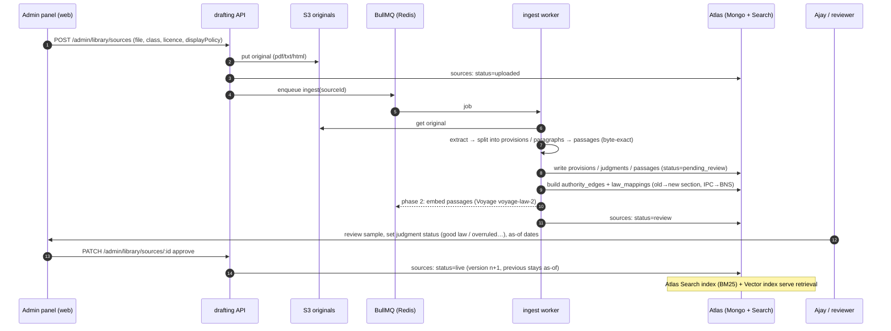
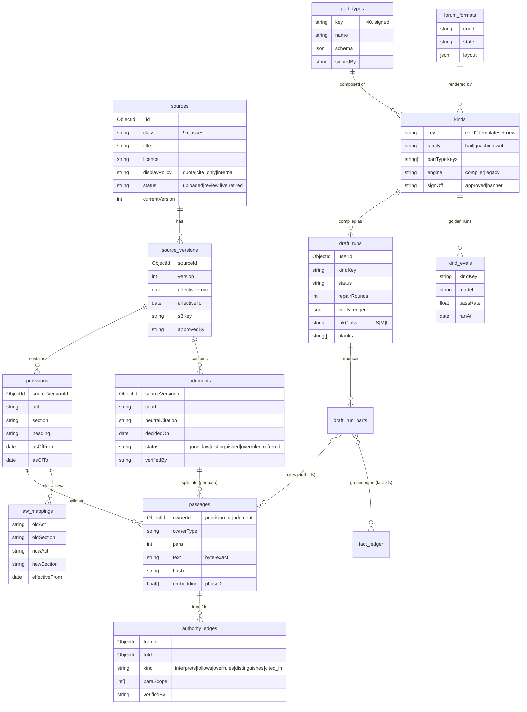
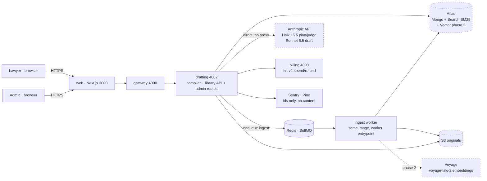
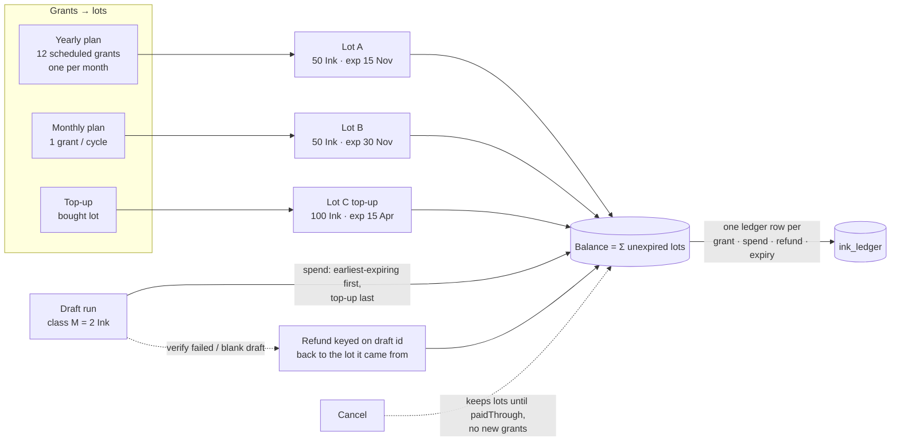
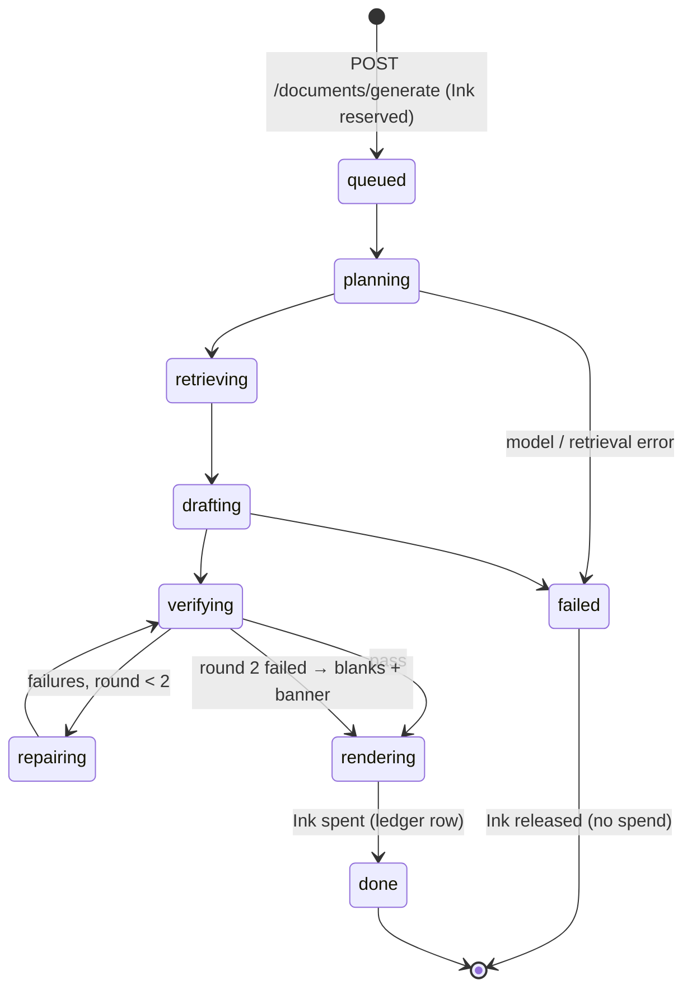

# Drafting v2 — diagrams (ADR-026)

Arjun, 15 Oct 2026. Rendered page for the founder: https://claude.ai/artifact/TLSLeyLGTovGCGm15bLP1j (private artifact; the same diagrams are kept here as Mermaid so the repo stays the source of truth). Companion to `00`–`06` in this folder.

## 0. Big picture

Three inputs — **Fact Ledger** (what the client said, every fact has an id), **Document Grammar** (~40 signed part types; kinds as data; the 92 templates become kinds) and **Law Library** (statutes, judgments, passages, mappings; versioned with as-of dates, byte-exact quotes) — feed one **Document Compiler** (plan → retrieve → draft → verify → repair ≤2 → render), which emits a draft with provenance: every sentence traces to fact ids, every citation to an authority id, citations rendered from metadata. *No authority id, no sentence; blanks never guesses.* Adding the 10,000th kind is an admin entry plus a sign-off, not a code change.

## 1. Compile pipeline — plan → retrieve → draft → verify → repair → render

```mermaid
flowchart LR
  I[Intake brief<br/>+ Fact Ledger] --> P
  subgraph C[Document Compiler · one draft_run]
    direction LR
    P[Plan<br/><i>Haiku</i><br/>kind + forum format<br/>→ AuthorityNeed list] -->|AuthorityNeed[]| R
    R[Retrieve<br/>BM25 + vector<br/>filters: forum, as-of,<br/>status, licence] -->|ContextPack<br/>passages with ids| D
    D[Draft<br/><i>Sonnet</i><br/>writes per part type<br/>emits ⟦auth:id⟧ ⟦fact:id⟧] -->|marked text| V
    V{Verify}
    V -->|deterministic:<br/>ids exist · quotes byte-equal<br/>as-of ok · forbids clean| J{Judge<br/><i>Haiku</i><br/>claim ⊆ passage?}
    J -->|all pass| X[Render<br/>markers → citations<br/>from metadata]
    V -->|failures| F[Repair<br/>same Sonnet session<br/>only the failed parts]
    J -->|failures| F
    F -->|round ≤ 2| V
    F -.->|round 3| B[Blank the part<br/>+ banner]
    B --> X
  end
  X --> O[Draft + provenance<br/>+ blanks list]
  L[(Law Library)] --> R
  G[(Grammar:<br/>part_types · kinds<br/>forum_formats)] --> P
```

Each stage is a separate model call with a typed contract (Plan, AuthorityNeed, ContextPack, VerifyResult in 04-lld). The drafter only sees passages the retriever handed it, and can only cite by id. The verifier is deterministic first (cheap, no model) and a Haiku judge second; failures go back to the same Sonnet session, at most twice. A part that still fails is rendered blank with a banner, never silently kept.

## 2. Law Library ingest — admin upload to live source



Nothing becomes retrievable until a human sets it live. Each approval creates a new version of the source; old versions stay for as-of lookups (a bail application filed in 2023 cites the 2023 text). Licence displayPolicy (quote / cite_only / internal) is enforced at render time, not at ingest.

## 3. Authority graph and law mappings

```mermaid
flowchart TB
  subgraph IPC[IPC 1860 · source v3 · as-of ≤ 30 Jun 2024]
    s420[IPC s.420 cheating]
  end
  subgraph BNS[BNS 2023 · source v1 · as-of ≥ 1 Jul 2024]
    s318[BNS s.318(4) cheating]
  end
  s420 -. law_mapping: renumbered .-> s318
  subgraph CrPC[CrPC 1973]
    s438[CrPC s.438 anticipatory bail]
  end
  subgraph BNSS[BNSS 2023]
    s482[BNSS s.482 anticipatory bail]
  end
  s438 -. law_mapping: renumbered .-> s482
  J1[Judgment A 2019<br/>para 12 · status good_law] -- interprets --> s438
  J2[Judgment B 2022<br/>para 7 · status good_law] -- follows --> J1
  J3[Judgment C 2024<br/>status overruled] -. overruled_by .-> J2
  s482 -- cited_in --> J4[Judgment D 2025<br/>para 3 · status good_law]
  J1 -- carried via mapping --> s482
  classDef dead stroke-dasharray:4 4,color:#888;
  class J3 dead
```

Edges (authority_edges) carry kind + paragraph scope + verifiedBy. A retrieval for “anticipatory bail, filed Sept 2026” resolves CrPC s.438 → BNSS s.482 through the mapping, pulls judgments that interpret either, and drops Judgment C because its status is overruled. The lawyer sees “Judgment A (on s.438 CrPC, now s.482 BNSS)” — the bridge is rendered from metadata, never written by the model.

## 4. Data model — collections (ERD)



Left side is the library (grows with every book the founder licenses); middle is the grammar (grows with every kind Ajay signs); right is runtime (draft_runs keeps the verifier ledger and every cited id, so any draft can be re-audited). Full field lists and indexes in 03-database-design.md.

## 5. Deployment — no new service



Everything new lives inside the existing drafting service and a worker entrypoint of the same image, so one deploy and one CI job. Atlas Search replaces a separate search engine; Voyage embeddings are phase 2 and revenue-gated (Vikram). Logs and Sentry carry ids only — no case content, no personal data.

## 6. Ink v2 — lots, spend order, ledger



Replaces drip + carry-over + separate counters with one rule set: every grant is a lot with an expiry; spend takes the earliest-expiring lot first and top-ups last; every movement is one ledger row; a refund is idempotent on draft id. Yearly is just twelve scheduled grants. Migration: existing balances become two lots (plan + top-up). Month-end liability report = Σ unexpired lots.

## 7. Draft run lifecycle — Ink reserved, spent only on done



Ink is reserved at queue time and spent only on done; any failure before render releases the reservation, so a user never pays for a draft that did not render.

## 8. Rollout phases

```mermaid
gantt
  title Drafting v2 rollout (after T-403 v1 release)
  dateFormat YYYY-MM-DD
  axisFormat %b
  section Phase 0 · Foundations
  Grammar: part_types + kinds registry, 92 → kinds (engine=legacy)   :p0a, 2026-11-01, 21d
  Library schema + admin upload + ingest worker (free primary sources) :p0b, 2026-11-01, 28d
  Ink v2 lots + ledger + migration                                     :p0c, 2026-11-10, 21d
  section Phase 1 · Compiler
  Plan / retrieve (BM25) / draft / deterministic verify / render       :p1a, after p0b, 35d
  Bail family on compiler, golden runs with Ajay                       :p1b, after p1a, 14d
  section Phase 2 · Depth
  Vector retrieval (Voyage), judge stage, authority graph UI           :p2a, after p1b, 28d
  Quashing + writ families                                             :p2b, after p2a, 21d
  section Phase 3 · Scale
  Admin kind authoring, kind_evals dashboard, licensed books           :p3, after p2b, 42d
```

Dates are indicative, sequenced after v1 goes to main; each phase ships behind the per-kind engine switch, so the 92 keep working on the legacy engine until a kind is moved and signed.

## 9. Decisions D1–D10

See `00-adr-026-drafting-v2.md` §7–9; the rendered page carries the same table with my recommendation per row.
